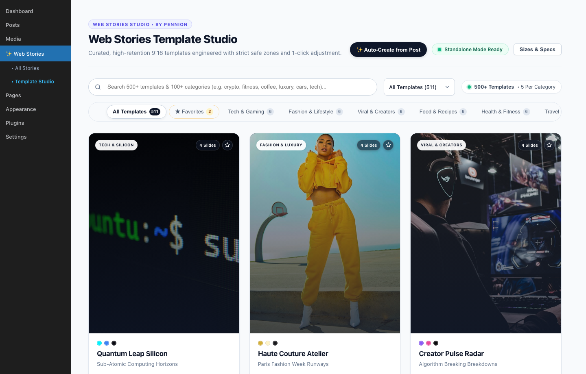
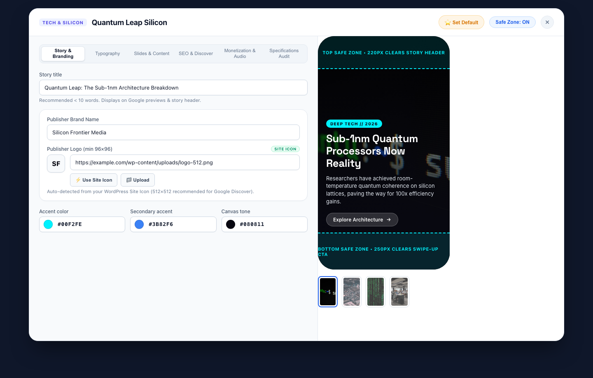
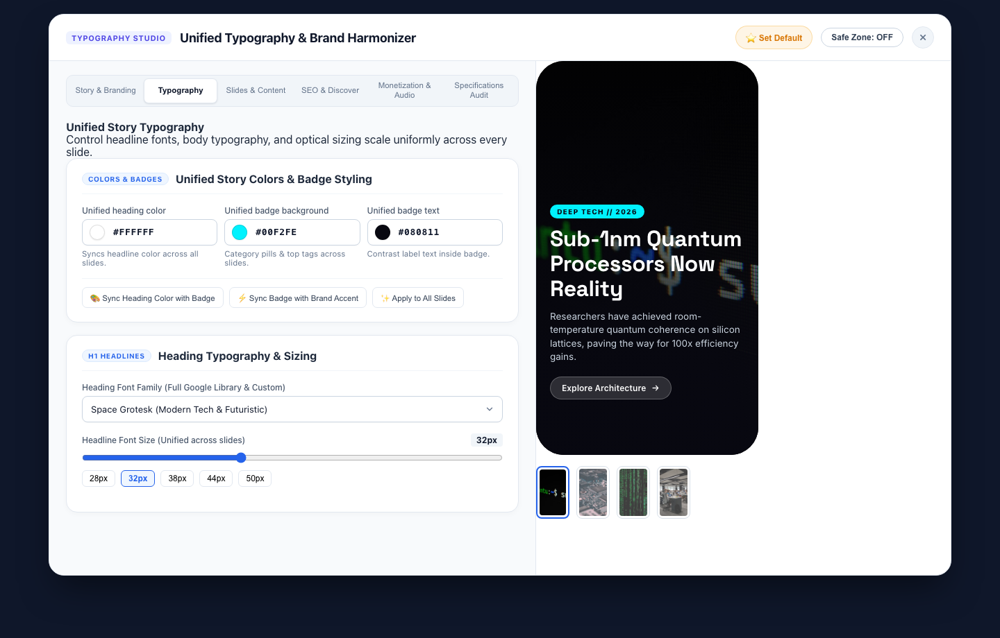
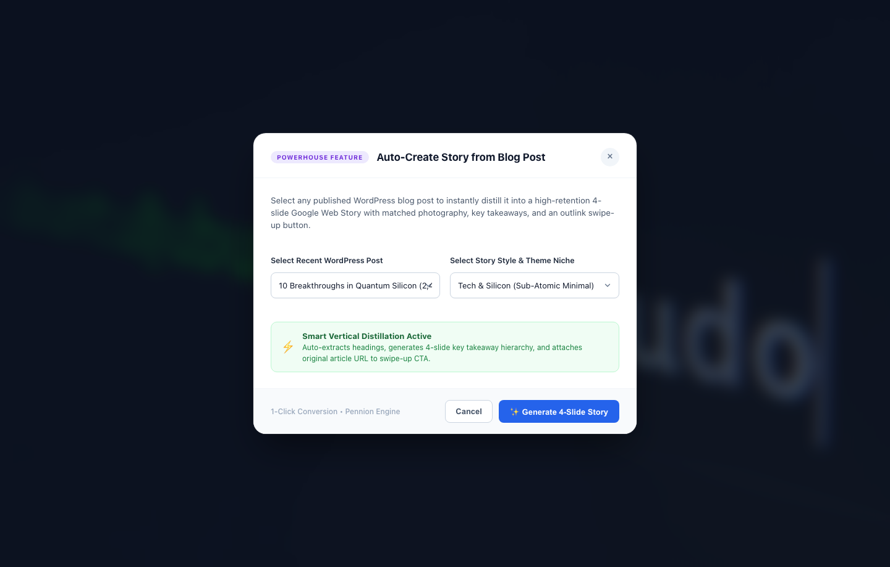

<div align="center">

# Web Stories Templates Studio

**Curated, high-retention 9:16 templates engineered with strict safe zones for Google Web Stories on WordPress.**

[](https://github.com/ursishant/web-stories-templates-studio/releases)
[](https://ursishant.github.io/web-stories-templates-studio/)
[](https://wordpress.org)
[](https://www.php.net)
[](https://amp.dev/about/stories/)
[](LICENSE)
[](#-template-categories)

<br>



</div>

---

## ⚡ Overview

**Web Stories Templates Studio** provides a massive catalog of **500+ high-retention visual templates** engineered specifically for **Google Web Stories on WordPress**. Every template is built with 5 unique design archetypes per category across 100+ niches (Crypto, AI & Robotics, Haute Cuisine, Fitness, Luxury Lifestyle, Travel, Streetwear, Gaming, and more).

Unlike generic story builders that place critical text underneath browser navigation bars or swipe-up banners, **Web Stories Templates Studio** enforces Google's official design bounds and safe zones by default — guaranteeing your headlines, badges, and CTAs render with zero clipping across every iOS and Android device.

---

## 📸 Visual Tour & Screenshots

### 1. Template Studio & 500+ Curated Catalog
> Instant fuzzy search, 100+ category filters, 1-click favorites, and active default template management.


---

### 2. Live Phone Simulator & Safe Zone Visual Inspector
> Real-time 9:16 mobile mockup enforcing Google Web Stories 220px top boundary (clearing header UI) and 250px bottom boundary (clearing swipe-up CTAs).



---

### 3. Story Typography, Branding & Color Harmonizer
> Full Google Fonts library, fluid optical font size sliders, and 1-click palette synchronization across all slides.



---

### 4. 1-Click Blog-to-Story Distiller
> Distill any published WordPress article into a high-retention 4-slide AMP Web Story with key takeaways and swipe-up attribution outlink.



---

## ✨ Key Features

- **500+ Handcrafted Templates across 100+ Niches:** 5 unique, bespoke slide archetypes for every category.
- **Strict Safe Zone Enforcement:** Built-in guard overlays protecting the 220px top boundary (progress bars, audio toggles, publisher monogram) and 250px bottom boundary (swipe-up gesture, attribution CTAs).
- **Auto-Create Story from Blog Post:** 1-Click distiller converts any existing WordPress blog post into a high-retention 4-slide AMP Web Story with matched photography and outlink swipe-up button.
- **Unified Story Typography & Branding:** Full curated Google Fonts library (60+ fonts in categorized optgroups) plus custom font URL support, synchronized color schemes, and 1-click palette harmonization.
- **Interactive Live Simulator:** Preview your story in real-time with responsive device frames, zero-tooltip navigation, and spring microinteractions.
- **Favorites & Instant Search:** Bookmark go-to templates with one click and filter through 100+ categories instantly with fuzzy search.
- **Standalone Mode & Google Web Stories Integration:** Operates seamlessly standalone with built-in AMP HTML rendering, or integrates directly with the official Google Web Stories for WordPress plugin.
- **Shortcode Embeds:** Embed responsive story players anywhere with `[sick_web_story id="123"]`.

---

## 📐 Google Web Stories Specification Compliance

| Specification | Standard | WSTS Enforcement |
|---|---|---|
| **Canvas Dimensions** | 1080 × 1920 px | Strict 9:16 vertical aspect ratio |
| **Top Safe Zone** | 220 px top margin | Clears story progress bars, logo & controls |
| **Bottom Safe Zone** | 250 px bottom margin | Clears swipe-up outlink buttons & system bars |
| **Poster Cover Image** | 3:4 portrait (640 × 853 px min) | Enforced 960 × 1280 px recommended upload |
| **Publisher Logo** | 1:1 square monogram (96 × 96 px min) | 512 × 512 px auto-sync from WP Site Icon |
| **Typography Density** | Max 280 characters / slide | Live character counter with warning guards |
| **AMP Validation** | Valid `<amp-story>` schema | Zero AMP validation errors out of the box |

---

## 🚀 Installation

### Option 1: Upload via WordPress Admin (Recommended)
1. Download the latest `web-stories-templates.zip` from [Releases](https://github.com/ursishant/web-stories-templates-studio/releases).
2. In your WordPress admin dashboard, navigate to **Plugins > Add New > Upload Plugin**.
3. Choose the downloaded `.zip` file and click **Install Now**.
4. Click **Activate Plugin**.
5. Go to **Web Stories > Template Studio** in your admin menu.

### Option 2: Clone via Git
Navigate to your WordPress plugins directory and clone this repository:
```bash
cd wp-content/plugins/
git clone https://github.com/ursishant/web-stories-templates-studio.git web-stories-templates
```
Activate the plugin via **WP Admin > Plugins** or via WP-CLI:
```bash
wp plugin activate web-stories-templates
```

---

## 🎨 Template Categories

With over 100 categories and 500+ templates, here are a few examples:
- **Tech & Future:** AI & Machine Learning, Robotics, Cyber Tech, Crypto & Web3, Quantum Computing, Mobile Hardware
- **Lifestyle & Luxury:** Haute Couture, Fine Jewelry, Perfumery, Vintage Thrifting, Streetwear
- **Food & Hospitality:** Artisanal Bakery, Mixology, Farm to Table, Gourmet Cuisine, Street Food
- **Fitness & Wellness:** HIIT Training, Marathon Running, Pilates, Yoga & Mindfulness, Biohacking
- **Travel & Adventure:** Deep Sea Diving, Alpine Mountaineering, Van Life, City Weekend Guides
- **Business & Growth:** Venture Capital, B2B SaaS, Bootstrapping, Real Estate Investing

---

## 🧩 Shortcode Usage

Embed any created story directly into WordPress posts, pages, or widget blocks:

```html
<!-- Default 3-column responsive card player -->
[sick_web_story id="42"]

<!-- Custom display view and height -->
[sick_web_story id="42" view="grid" columns="2" height="600"]
```

---

## 📁 Repository Structure

```
web-stories-templates/
├── assets/
│   ├── css/
│   │   └── admin-studio.css       # Studio UI & simulator styles
│   ├── images/
│   │   ├── default-logo.png       # Fallback publisher monograms
│   │   └── default-logo.svg
│   ├── js/
│   │   └── admin-studio.js        # Interactive studio logic & AJAX handlers
│   ├── screenshot-1.png           # Template Studio Catalog
│   ├── screenshot-2.png           # Live Phone Simulator & Safe Zone Inspector
│   ├── screenshot-3.png           # Typography Studio & Brand Harmonizer
│   └── screenshot-4.png           # Auto-Create Story from Blog Post Distiller
├── includes/
│   ├── class-admin-studio.php     # WordPress admin page & views
│   ├── class-ajax-handler.php     # AJAX endpoints (save, favorite, distill)
│   ├── class-spec-validator.php   # Google Web Stories spec validation
│   ├── class-story-builder.php    # Story compiler & AMP HTML generator
│   ├── class-story-player.php     # Shortcode renderer & embed player
│   ├── class-template-registry.php# Template registration engine
│   └── templates-catalog.php      # 500+ pre-registered templates catalog
├── .github/
│   └── workflows/
│       └── build-release.yml      # Automated release packager
├── .gitignore
├── LICENSE                        # GNU General Public License v2
├── readme.txt                     # WordPress.org plugin directory readme
├── README.md                      # GitHub repository documentation
└── web-stories-templates.php      # Main plugin bootstrap file
```

---

## 🤝 Contributing

Contributions, feature ideas, and PRs are warmly welcome!
1. Fork the Project
2. Create your Feature Branch (`git checkout -b feature/AmazingTemplate`)
3. Commit your Changes (`git commit -m 'feat: Add new Cyberpunk template'`)
4. Push to the Branch (`git push origin feature/AmazingTemplate`)
5. Open a Pull Request

---

## 📄 License

Distributed under the GNU General Public License v2 or later. See [`LICENSE`](LICENSE) for more details.

---

<div align="center">
Crafted with ❤️ by <a href="https://pennion.com">pennion</a> & <a href="https://github.com/ursishant">ursishant</a>
</div>
